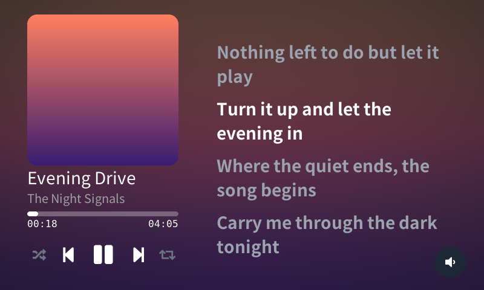

# Raira

> ⚠️ **이 프로젝트는 아직 개발 중입니다.** 바뀌거나, 동작하지 않거나, 빠진 기능이 있을 수 있습니다.

[English](README.md) | **한국어**

Raira는 Spotify Car Thing에서 영감을 받은 미디어 컨트롤러입니다. 특정 음악 서비스에 묶이지 않고, 차 안뿐 아니라 어디서든 쓰고 싶어서 시작한 프로젝트입니다.

PC에서 재생 중인 곡의 커버, 제목, 진행 상태, 싱크 가사를 작은 터치스크린에 보여줍니다. 재생/일시정지, 건너뛰기, 탐색, 셔플, 반복, 볼륨은 화면을 터치하거나 다이얼을 돌려서 조작합니다.

## 어떻게 동작하나요?

Raira 기기는 리모컨일 뿐이고, 음악은 평소처럼 PC에서 재생됩니다. PC에서는 Raira와 통신하기 위해 **브리지**라는 프로그램이 돌면서 지금 재생 중인 곡을 기기에 알려주고, 기기의 조작을 플레이어에 전달합니다.

- Spotify, Tidal, 브라우저 등 Linux의 미디어 컨트롤(MPRIS)을 지원하는 플레이어는 대부분 쓸 수 있습니다.
- 처음 한 번만 기기 화면에 뜨는 6자리 코드를 브리지에 입력하면 연결됩니다. 이후에는 같은 WiFi 안에서 자동으로 서로를 찾습니다.
- 가사는 브리지가 [LRCLIB](https://lrclib.net)에서 찾아서 보내줍니다.

## 필요한 것들

Raira는 현재 아래와 같은 것들을 필요로 합니다.

- ESP32-P4 보드 (Guition JC4880P443C_I_W을 이용해 테스트 하였습니다.)
- Linux 탑재 PC (Windows도 지원 예정입니다.)

## 상태

| 부분                                                  | 상태      |
| ----------------------------------------------------- | --------- |
| PC용 시뮬레이터(실제 기기 없이 화면을 체험)           | ✅        |
| Linux용 브리지(트레이 아이콘, 설정 페이지, 가사 포함) | ✅        |
| ESP32-P4 기기(보드: JC4880P443C_I_W)에서 동작 확인    | ✅        |
| 엔코더로 볼륨 조작                                    | ✅        |
| Windows용 브리지                                      | 개발 예정 |

## 스트리밍 서비스별 작동 확인 현황

| 서비스명          | 상태 |
| ----------------- | ---- |
| Spotify           | ✅   |
| Tidal(Tidal-hifi) | ✅   |

## 직접 써보기

지금은 PC 쪽이 Linux에서만 동작합니다. 기기가 없어도 시뮬레이터로 화면을 먼저 체험할 수 있습니다.

필요한 것: C++23 컴파일러, CMake, SDL2, libturbojpeg, libwebsockets, nlohmann_json, Rust.

    cmake -B build && cmake --build build -j
    build/bin/lvglsim                 # 시뮬레이터 실행
    cd bridge && cargo run            # 브리지 실행

1. 시뮬레이터에서 Settings > Sources > Pair a source를 엽니다.
2. 브리지의 설정 페이지(`http://127.0.0.1:18801/`)를 열고 화면에 뜬 코드를 입력합니다.
3. 연결이 자동으로 안 되면 브리지를 `--device 127.0.0.1:18322`로 시작해 보세요.

브리지를 로그인할 때마다 자동으로 켜지게 하려면 `tools/install_bridge.sh`를 실행하세요. 되돌리려면 `--uninstall`을 붙입니다.

이는 추후에 쉽게 사용할 수 있도록 인스톨러 같은 방식으로 제공될 예정입니다.

## 실제 기기 만들기

ESP32-P4 보드(JC4880P443C_I_W)용 펌웨어가 `firmware/`에 있습니다(ESP-IDF v6.1). `tools/firmware_build.sh`로 빌드하고, 플래시 방법은 `docs/PORTING.md`(영어)에 있습니다. 로터리 엔코더(EC11)를 달면 다이얼로 볼륨을 조절하고 눌러서 재생/일시정지를 할 수 있습니다.

## 크레딧과 라이선스

MIT 라이선스입니다(`LICENSE`). [LVGL](https://github.com/lvgl/lvgl)(MIT), [nlohmann/json](https://github.com/nlohmann/json)(MIT), Noto Sans CJK 서브셋(SIL OFL 1.1, `assets/fonts/OFL.txt`), DejaVu Sans Mono로 만든 비트맵 폰트를 포함합니다. 가사는 LRCLIB에서 가져오니 요청 제한을 지켜주세요.
