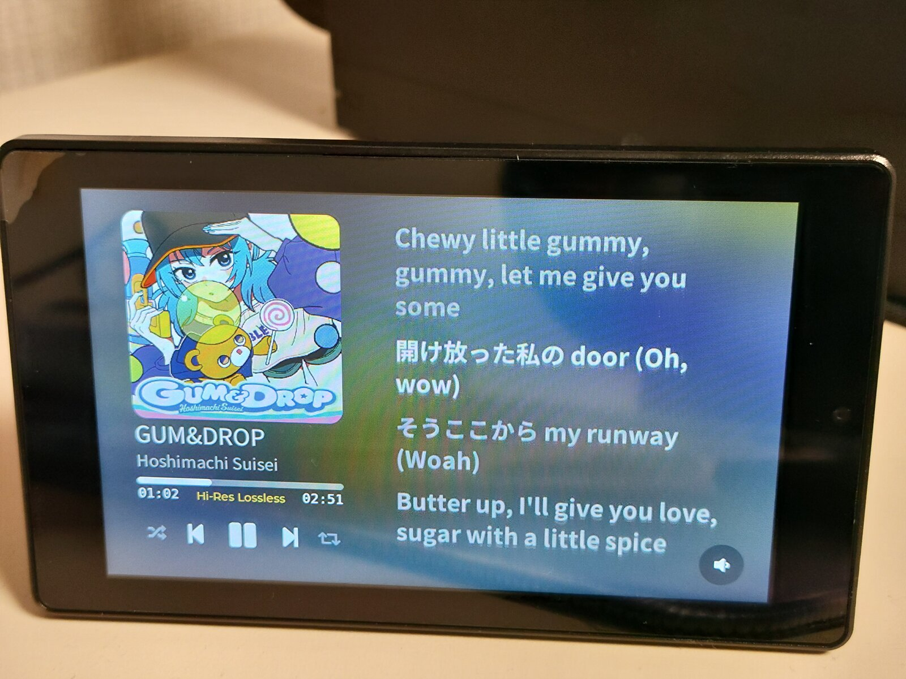
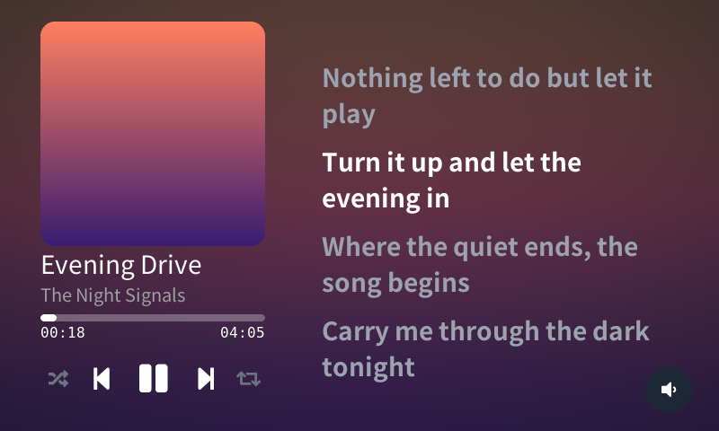

# Raira

> ⚠️ **This project is still under development.** Things may change, break or be missing.

**English** | [한국어](README.ko.md)

Raira is a media controller inspired by the Spotify Car Thing. It is not tied to one music service, and I started it because I wanted something I could use anywhere, not just in the car.

It shows what is playing on your PC (cover, title, progress, synced lyrics) on a small touch screen. You play/pause, skip, seek, shuffle, repeat and change the volume by touching the screen or turning the dial.

## How does it work?

The Raira device is only a remote; the music keeps playing on your PC as usual. To talk to Raira, a program on the PC called the **bridge** tells the device what is playing and passes the device's commands on to the player.

- Most players that support Linux media controls (MPRIS) work, such as Spotify, Tidal and browsers.
- You connect them once by typing the six-digit code shown on the device into the bridge. After that they find each other on the same WiFi by themselves.
- The bridge looks up lyrics on [LRCLIB](https://lrclib.net) and sends them to the device.

## What you need

Raira currently needs:

- An ESP32-P4 board (tested with the Guition JC4880P443C_I_W)
- A PC running Linux (Windows support is planned)

## Status

| part                                                              | state   |
| ----------------------------------------------------------------- | ------- |
| Simulator for the PC (try the screen without the hardware)        | ✅      |
| Bridge for Linux (tray icon, settings page, lyrics)               | ✅      |
| Confirmed working on the ESP32-P4 device (JC4880P443C_I_W)        | ✅      |
| Volume control with the encoder                                   | ✅      |
| Bridge for Windows                                                | planned |

## Tested streaming services

| service           | state |
| ----------------- | ----- |
| Spotify           | ✅    |
| Tidal (tidal-hifi) | ✅   |

## Try it yourself

For now the PC side runs on Linux only. You can try the screen with the simulator, no device needed.

You need: a C++23 compiler, CMake, SDL2, libturbojpeg, libwebsockets, nlohmann_json, and Rust.

    cmake -B build && cmake --build build -j
    build/bin/lvglsim                 # start the simulator
    cd bridge && cargo run            # start the bridge

1. In the simulator, open Settings > Sources > Pair a source.
2. Open the bridge's settings page (`http://127.0.0.1:18801/`) and type the code shown on the screen.
3. If they do not connect on their own, start the bridge with `--device 127.0.0.1:18322`.

To have the bridge start at every login, run `tools/install_bridge.sh`. Add `--uninstall` to undo it.

An installer that makes this easier is planned.

## Building the real device

The firmware for the ESP32-P4 board (JC4880P443C_I_W) is in `firmware/` (ESP-IDF v6.1). Build it with `tools/firmware_build.sh`; how to flash it is in `docs/PORTING.md`. With a rotary encoder (EC11) attached you can change the volume with the dial and press it to play/pause.

## Credits and licenses

MIT licensed (`LICENSE`). It includes [LVGL](https://github.com/lvgl/lvgl) (MIT), [nlohmann/json](https://github.com/nlohmann/json) (MIT), subsets of Noto Sans CJK (SIL OFL 1.1, `assets/fonts/OFL.txt`) and a bitmap font made from DejaVu Sans Mono. Lyrics come from LRCLIB; please keep its rate limits in mind.
